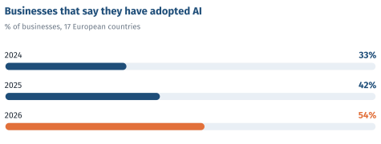
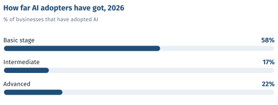
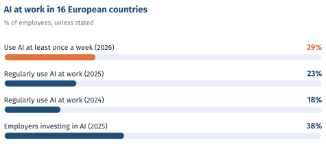
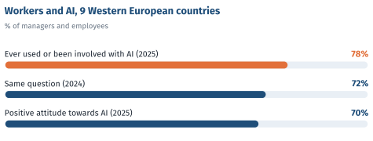
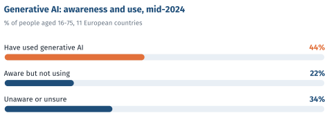
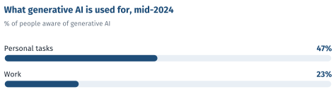

Surveys run or commissioned by private companies. Most use online panels and loose definitions of "using AI", and publish little on method, so they are not plotted on the overview.

## AWS / Strand Partners

**[Unlocking Europe's AI Potential 2026](https://www.unlockingeuropesaipotential.com/_files/ugd/c4ce6f_e3480cb3bb59487d9428059e7f5019e7.pdf)** · Amazon Web Services, fieldwork by Strand Partners · published March 2026, fieldwork dates not stated · Firms, 17,000 business leaders in 17 European countries (14 in the EU). Asks whether the business has adopted AI; exact wording not published.

{fig-alt="Share of European businesses that say they have adopted AI: 33% in 2024, 42% in 2025, 54% in 2026."}

{fig-alt="AI adopters by stage in 2026: basic 58%, intermediate 17%, advanced 22%; the published shares sum to 97%."}

## SD Worx

**[HR and Payroll Pulse 2026](https://www.sdworx.com/en-en/about-sd-worx/press/2026-07-16-seven-out-ten-european-ai-users-say-they-work-more-efficiently-thanks-ai)** · SD Worx, fieldwork by iVOX · 27 January to 20 February 2026 · Workers and firms, 16,500 employees and 5,936 HR decision-makers in 16 European countries (13 in the EU). Asks whether and how often employees use AI at work; exact wording not published.

{fig-alt="SD Worx: 29% of European employees used AI at least once a week in 2026; in 2025, 23% used AI regularly at work, up from 18% in 2024, and 38% of employers invested in AI."}

## EY

**[European AI Barometer 2025](https://www.ey.com/content/dam/ey-unified-site/ey-com/es-es/insights/ai/documents/ey-european-ai-barometer-2025.pdf)** · EY · March 2025 · Workers, 4,942 managers and employees in 9 Western European countries (8 in the EU). "Have you ever been involved with Artificial Intelligence (for example ChatGPT, Perplexity, Midjourney) or have you actively used it?"

{fig-alt="EY European AI Barometer: 78% of workers had ever used or been involved with AI in 2025, up from 72% in 2024; 70% have a positive attitude towards AI."}

## Deloitte

**[Trust in generative AI: a European perspective](https://www.deloitte.com/global/en/insights/topics/digital-transformation/trust-in-generative-ai-in-europe.html)** · Deloitte · 28 June to 12 August 2024 · Individuals, 30,252 people aged 16 to 75 in 11 European countries (9 in the EU). "Have you ever used any generative AI tools, or not?"

{fig-alt="Deloitte 2024, all respondents: 44% had used generative AI, 22% were aware but not using it, 34% were unaware or unsure."}

{fig-alt="Among people aware of generative AI: 47% used it for personal tasks, 23% for work."}
