National surveys with their own AI questions, from central banks, statistical offices and research institutes. They cover one country each, so they are not plotted on the overview.

## Germany

**[ifo Business Survey](https://www.ifo.de/fakten/2026-06-05/mehr-als-die-haelfte-der-unternehmen-nutzt-kuenstliche-intelligenz)** · ifo Institute · May 2026 · Firms, about 9,000. Asks whether AI is in use, planned, under discussion, or not an issue.

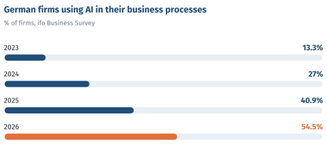{fig-alt="Share of German firms using AI: 13.3% in 2023, 27% in 2024, 40.9% in 2025, 54.5% in 2026."}

**[Bundesbank Online Panel Firms](https://publikationen.bundesbank.de/publikationen-en/reports-studies/monthly-reports/monthly-report-march-2026-991174)** · Deutsche Bundesbank, Monthly Report March 2026, box "Generative AI in German enterprises: adoption, costs and expected economic impact" (pp. 109-110) · April to June 2025 · Firms, more than 7,000. "Has your enterprise already used generative artificial intelligence (AI) or is it planning to use it in future?", asked for 2024, 2025 and 2026.

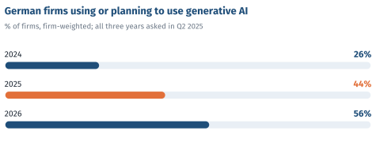{fig-alt="German firms using or planning to use generative AI, all asked in the second quarter of 2025: 26% for 2024, 44% for 2025 and 56% for 2026."}

**[IAB Establishment Panel](https://doku.iab.de/kurzber/2026/kb2026-08.pdf)** · Institute for Employment Research · July to November 2025 · Firms, about 15,000 establishments of all sizes. Asks whether the establishment uses generative AI, and since when.

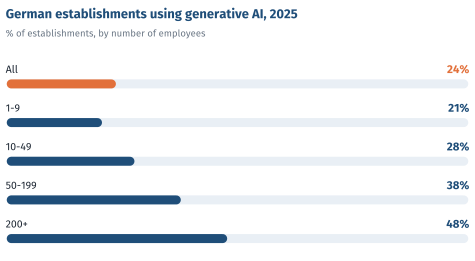{fig-alt="German establishments using generative AI in 2025: all 24%; 21% with 1 to 9 employees, 28% with 10 to 49, 38% with 50 to 199, 48% with 200 or more."}

**[DiWaBe 2.0](https://www.ifo.de/DocDL/WP-2025-422_Schlenker-etal_AI-Diffusion-in-the-Workplace.pdf)** · BAuA, ZEW, IAB and BIBB · July to December 2024 · Workers, 9,835 employees aged 16 to 65. "How often do you work with AI-supported computer programs?"

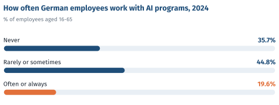{fig-alt="German employees in 2024: 35.7% never work with AI programs, 44.8% rarely or sometimes, 19.6% often or always."}

## France

**[Monthly business survey, AI module](https://www.banque-france.fr/system/files/2026-09/BDF266-1_IA-et-entreprises_web.pdf)** · Banque de France · 25 February to 3 April 2026 · Firms, about 7,000; results for those with 20+ employees. Asks what use the firm makes of generative and non-generative AI: intensive, limited, experimental, planned, or none.

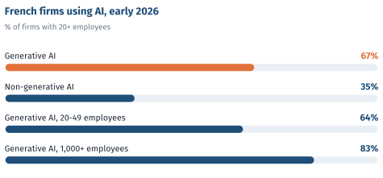{fig-alt="French firms with 20 or more employees: 67% use generative AI, 35% non-generative AI; generative AI 64% among firms with 20 to 49 employees and 83% among those with 1,000 or more."}

## Italy

**[Survey of Industrial and Service Firms](https://www.bancaditalia.it/pubblicazioni/indagine-imprese/2025-indagini-imprese/statistiche_IIS_01072026.pdf)** · Banca d'Italia · 17 February to 12 May 2026 · Firms, about 4,000 with 20+ employees. Asks what use the firm makes of predictive and generative AI: extensive, limited, experimental, planned, or none.

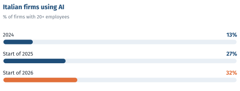{fig-alt="Italian firms with 20 or more employees using AI: 13% in 2024, 27% at the start of 2025, 32% at the start of 2026."}

## Spain

**[Business Activity Survey (EBAE)](https://www.bde.es/f/webbe/SES/Secciones/Publicaciones/InformesBoletinesRevistas/BoletinEconomico/25/T2/Fich/be2502-art06.pdf)** · Banco de España · 11 to 25 November 2024 · Firms, about 6,300 of all sizes. Asks how much the firm uses predictive and generative AI: none, planned, sporadic or pilot, moderate, or high.

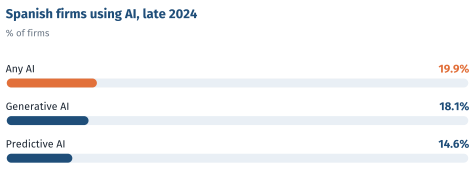{fig-alt="Spanish firms using AI in late 2024: any AI 19.9%, generative AI 18.1%, predictive AI 14.6%."}

## Austria

**[AI use and attitudes](https://www.statistik.at/fileadmin/announcement/2026/10/20261007KINutzungEinstellung2025.pdf)** · Statistics Austria · April to July 2025 · Individuals, 5,550 people aged 16 to 74. Asks whether people have used AI tools to generate text, images or other content, and how often in the last three months.

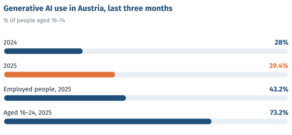{fig-alt="Austria: 28% used generative AI in the last three months in 2024, 39.4% in 2025; 43.2% of employed people and 73.2% of those aged 16 to 24 in 2025."}

## Netherlands

**[Belevingen 2025, AI module](https://www.cbs.nl/nl-nl/longread/diversen/2026/ai-in-de-samenleving-ervaringen-en-opinies?onepage=true)** · Statistics Netherlands (CBS) · 23 January to 30 June 2025 · Individuals, 3,834 adults aged 18+; the work question goes to those in paid work. "Gebruikt u op dit moment kunstmatige intelligentie voor uw werk?" (Do you currently use artificial intelligence for your work?)

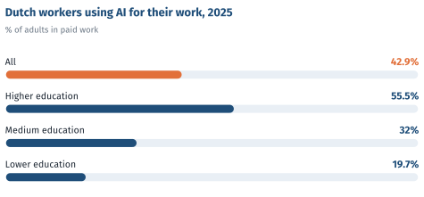{fig-alt="Dutch adults in paid work using AI for their work in 2025: all 42.9%, higher education 55.5%, medium education 32%, lower education 19.7%."}

**[Employers' Survey on Work (WEA) 2024](https://publications.tno.nl/publication/34643255/cDUIbhfh/TNO-2024-R11757.pdf)** · TNO · 15 January to 29 May 2024 · Firms, 3,460 establishments with 5+ employees. Asks which technologies the establishment uses, including "algorithms, artificial intelligence (AI) or big data techniques to improve processes, products or services".

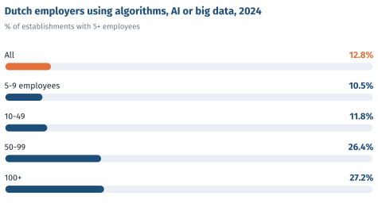{fig-alt="Dutch establishments using algorithms, AI or big data in 2024: all 12.8%; 10.5% with 5 to 9 employees, 11.8% with 10 to 49, 26.4% with 50 to 99, 27.2% with 100 or more."}

## Denmark

**[AI chatbot adoption surveys](https://bfi.uchicago.edu/wp-content/uploads/2025/04/BFI_WP_2025-56-3.pdf)** · Humlum and Vestergaard, fielded by Statistics Denmark · November to December 2024 (first wave late 2023) · Workers, 25,241 in 11 AI-exposed occupations covering about a fifth of Danish employment. "Har du benyttet følgende AI chatbots?" (Have you used the following AI chatbots?), with answers for work and for leisure.

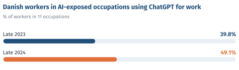{fig-alt="Danish workers in 11 AI-exposed occupations who used ChatGPT for work: 39.8% in late 2023, 49.1% in late 2024."}

## Finland

**[Generative AI module, EVA values and attitudes survey](https://etla.fi/wp-content/uploads/ETLA-Muistio-Brief-144.pdf)** · ETLA · 8 to 21 October 2024 · Individuals, 2,018 people aged 18 to 79. Asks how often people used an AI web application in the last 12 months, and whether they have used AI for a task in their job.

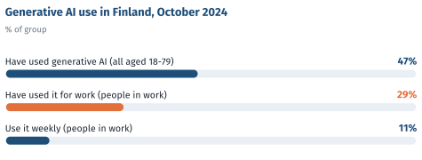{fig-alt="Finland, October 2024: 47% of people aged 18 to 79 have used generative AI; 29% of people in work have used it for work and 11% use it weekly."}

**[Working Life Barometer 2025](https://valtioneuvosto.fi/-/1410877/tyoolobarometri-palkansaajat-varovaisen-myonteisia-tekoalyn-kaytosta-tyopaikoilla)** · Ministry of Economic Affairs and Employment, data collected by Statistics Finland · autumn 2025 · Workers, wage earners aged 18 to 64. Asks whether AI technology is used at the respondent's workplace, and with what effects.

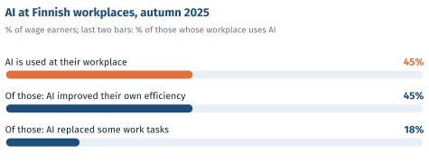{fig-alt="Finnish wage earners, autumn 2025: 45% say AI is used at their workplace. Of those, 45% say it improved their own efficiency and 18% say it replaced some work tasks."}

## Poland

**[NBP Quick Monitoring Survey](https://nbp.pl/publikacje/cykliczne-materialy-analityczne-nbp/szybki-monitoring/)** · Narodowy Bank Polski · quarterly; AI questions in the reports for Q4 2024 and Q2 2026 · Firms, non-financial enterprises of all sizes. Asks whether the firm uses AI tools or plans to. Figures are taken from press reports of the survey, not from the NBP publication itself.

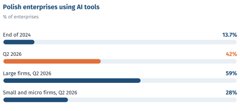{fig-alt="Polish enterprises using AI tools: 13.7% at the end of 2024, 42% in the second quarter of 2026; 59% of large firms and 28% of small and micro firms in 2026."}
