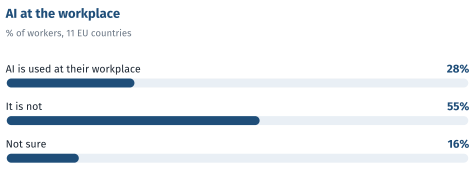
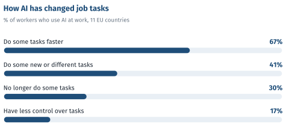

{fig-alt="28% of workers in 11 EU countries say AI is used at their workplace, 55% say it is not, 16% are not sure."}

{fig-alt="How AI changed job tasks: 67% do some tasks faster, 41% do new or different tasks, 30% no longer do some tasks, 17% have less control."}

