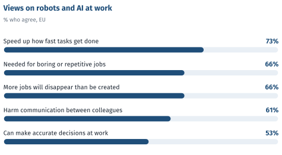
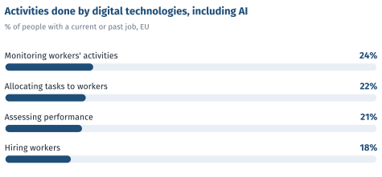

{fig-alt="Share agreeing that robots and AI: speed up tasks 73%, are needed for boring jobs 66%, will destroy more jobs than they create 66%, harm communication between colleagues 61%, can make accurate decisions 53%."}

{fig-alt="Activities performed by digital technologies in the workplace: monitoring workers 24%, allocating tasks 22%, assessing performance 21%, hiring 18%."}
