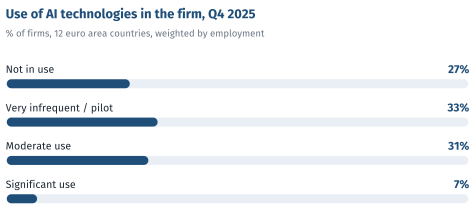
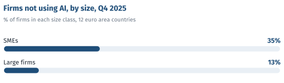

{fig-alt="Euro area firms by intensity of AI use: not in use 27%, very infrequent or pilot 33%, moderate 31%, significant 7%."}

{fig-alt="Share of euro area firms not using AI: SMEs 35%, large firms 13%."}
