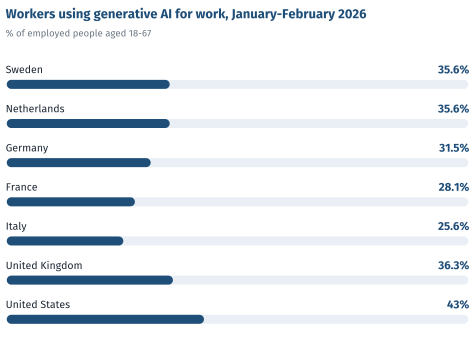

{fig-alt="Share of workers using generative AI for work, January-February 2026: Sweden 35.6%, Netherlands 35.6%, Germany 31.5%, France 28.1%, Italy 25.6%; United Kingdom 36.3%, United States 43%."}
